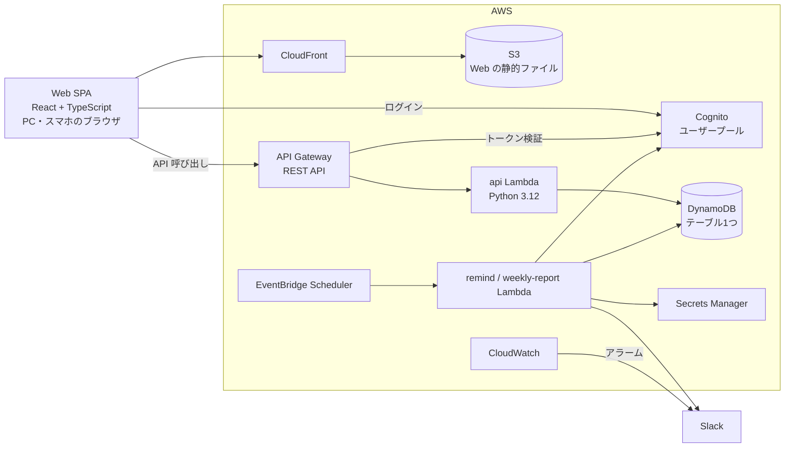
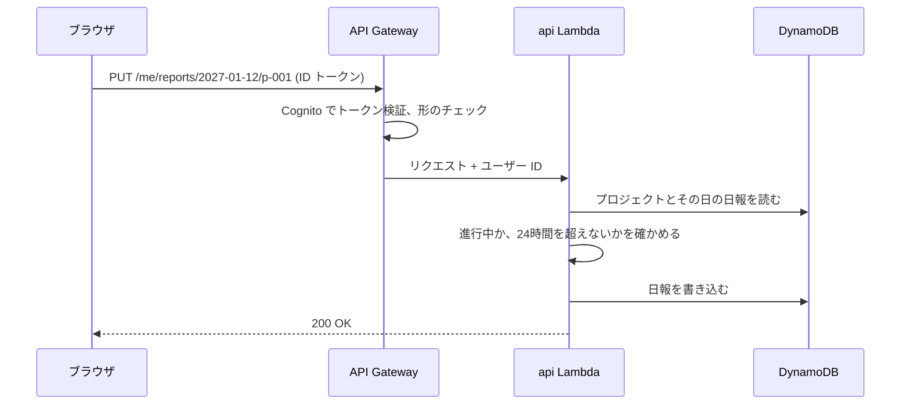

# アーキテクチャ

最終更新: 2026-11-23

## 全体構成

## 各サービスの役割

| サービス | 役割 | 選んだ理由 |
| --- | --- | --- |
| S3 + CloudFront | Web SPA の配信 | 静的ファイルだけなのでサーバー不要。CloudFront で HTTPS とキャッシュ。URL は CloudFront が付けるもの(`https://<id>.cloudfront.net`)を使う |
| Cognito | ログイン、ユーザーとグループ(admin / member)の管理 | API Gateway の認可と直接つながる。パスワード管理を自前で持たない |
| API Gateway(REST) | API の入口、トークン検証、リクエストの検証、スロットリング | Cognito オーソライザーと OpenAPI からの定義が使える |
| Lambda(Python) | API の処理、定期処理 | 呼ばれた分だけの課金 |
| DynamoDB | 全データの保存 | サーバーレスと相性がよく、アクセスパターンが決まっているので RDB は不要 |
| EventBridge Scheduler | 平日 18:00 の未提出者の投稿、月曜 9:00 の週次レポート | タイムゾーン(Asia/Tokyo)を指定できる |
| Secrets Manager | Slack の Incoming Webhook URL | URL を知っていれば誰でも投稿できるため、コードや環境変数に置かない |
| CloudWatch | ログ、メトリクス、アラーム | Lambda と API Gateway の標準 |
| AWS Budgets | 費用が月 500 円を超えたらメールで知らせる | 消し忘れや想定外のアクセスに気付くため |
| Slack | 未提出者の投稿、週次レポート、アラームの通知先 | 利用者が普段見ている場所に届ける |

スマホ専用のアプリは作らない。Web 画面をレスポンシブにし、スマホのブラウザからも同じ操作ができるようにする。

## 主な処理の流れ

### 日報を登録する

### 未提出者を知らせる

1. EventBridge Scheduler が平日 18:00(Asia/Tokyo)に remind Lambda を起動
2. Cognito から member の一覧を取り、当日の日報がない人を DynamoDB で確かめる
3. 未提出者の名前と入力画面へのリンクを、Slack のチャンネルに1回投稿する

## 環境

| 環境 | 用途 | デプロイ |
| --- | --- | --- |
| dev | 開発者の動作確認 | main へのマージで自動 |
| prod | 本番 | タグを打って手動承認 |

1つの AWS アカウントの中に、`backend/template.yaml`(AWS SAM)から環境ごとに別のスタックとして作る。

## 環境変数・シークレット

| 名前 | 置き場所 | 使う所 |
| --- | --- | --- |
| `TABLE_NAME` | Lambda 環境変数(SAM が設定) | 全 Lambda |
| `USER_POOL_ID` | Lambda 環境変数(SAM が設定) | remind Lambda |
| `SLACK_SECRET_ARN` | Lambda 環境変数 → Secrets Manager(Webhook URL) | remind / weekly-report Lambda、アラーム通知 |
| `APP_URL` | Lambda 環境変数 | remind Lambda(投稿のリンク) |
| `VITE_API_BASE_URL` | Web のビルド時変数 | Web |
| `VITE_COGNITO_USER_POOL_ID` / `VITE_COGNITO_CLIENT_ID` | Web のビルド時変数 | Web |

## 片付け

使い終わったら、すべて消して費用を0にする。

1. `sam delete --stack-name work-hours-report-<env>` で、Lambda、API Gateway、DynamoDB、Cognito、EventBridge Scheduler を消す
2. S3 のバケットを空にしてから消し、CloudFront のディストリビューションを無効にしてから消す
3. 残った CloudWatch のロググループと Secrets Manager のシークレットを消す
