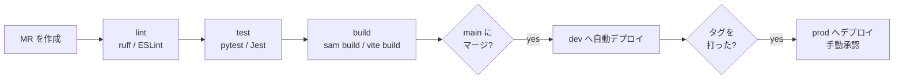

# 開発プロセス

最終更新: 2026-11-23

## リポジトリとブランチ

- GitLab のモノレポ(`api/`, `web/`, `backend/`)
- `main` は常にデプロイできる状態に保つ。作業は `feature/<イシュー番号>-<短い名前>` で行い、マージリクエスト(MR)で取り込む
- MR は CI が通り、1人以上が承認したらマージできる
- コミットメッセージは「何をなぜ変えたか」を1行目に書く

## CI/CD(GitLab CI)



- AWS への認証は GitLab の OIDC で一時的な権限を受け取る。アクセスキーを CI 変数に置かない
- 変更のあったディレクトリだけジョブを動かす(`rules: changes`)
- `api/openapi.yaml` が変わったら、型の生成をやり直して差分がないかを CI で確かめる

## テスト

| 対象 | 道具 | 何を確かめるか |
| --- | --- | --- |
| バックエンドのサービス層 | pytest | 24 時間チェック、締め月、終了したプロジェクト、集計の足し算などの業務ルール |
| バックエンドのリポジトリ層 | pytest + moto | DynamoDB のキーで正しく読み書きできるか |
| Web の部品 | Jest + Testing Library | 入力チェック、表示の切り替え |
| Web の API 呼び出し | Jest + MSW | エラー時の表示、キャッシュの更新 |

カバレッジの数字は目標にしない。

### テスト駆動(TDD)

Web は Jest でテスト駆動で作る。1つの振る舞いごとに、次の3つを繰り返す。

1. **Red**: まだない振る舞いのテストを1つ書き、失敗することを確かめる
2. **Green**: そのテストが通る最小のコードを書く
3. **Refactor**: テストが通ったまま、コードを読みやすく直す

例(日報の時間の入力チェック、`web/src/lib/hours.ts`):

```ts
// hours.test.ts を先に書く
test('15分単位でない時間はエラー', () => {
  expect(validateHours(1.1)).toBe('15分単位で入力してください');
});
test('0.25〜24時間は OK', () => {
  expect(validateHours(0.25)).toBeNull();
  expect(validateHours(24)).toBeNull();
});
```

- テストの名前は日本語で、何を確かめるかが読めるように書く
- 先に書くのは、業務のルール(時間の単位、1日24時間まで、締めた月)と、画面の振る舞い(保存したら一覧に出る、エラーが出る)
- 見た目(色や余白)はテストしない
- バックエンド(Python)も同じ進め方で、pytest で書く

## スクラム

| 項目 | 内容 |
| --- | --- |
| スプリント | 2週間 |
| バックログ | GitLab のイシュー。ユーザーストーリーの形で書き、受け入れ条件を付ける |
| 見積もり | ストーリーポイント(1, 2, 3, 5, 8) |
| イベント | プランニング(スプリント初日)、デイリー(15分)、レビュー(dev で動かして見せる)、レトロスペクティブ |
| 完成の定義 | MR がマージされ、テストがあり、dev で動き、関係する設計書が更新されている |

### 最初のバックログ(例)

| 順 | ストーリー | ポイント |
| --- | --- | --- |
| 1 | 作業者として、ログインして今日の作業時間を登録したい | 5 |
| 2 | 作業者として、今月の自分の日報を一覧で見たい | 3 |
| 3 | 管理者として、プロジェクトを登録したい | 3 |
| 4 | 管理者として、プロジェクトの予定と実績をグラフで比べたい | 5 |
| 5 | 作業者として、出し忘れた日に Slack で知らせてほしい | 3 |
| 6 | 管理者として、週の工数を Slack で受け取りたい | 3 |
| 7 | 管理者として、月の工数を CSV で取り出したい | 2 |

## AI エージェントの使い方

AI エージェント(Claude Code など)を開発の各工程で使う。使い方をそろえるため、リポジトリの直下に `CLAUDE.md`(AI に渡す決まりごと)を置く。

| 工程 | AI に任せること | 人がやること |
| --- | --- | --- |
| 設計 | 要件から API 定義やテーブル設計の案を出す | 案を比べて決める。決めたことを設計書に残す |
| 実装 | `openapi.yaml` と設計書を読ませて、ハンドラーやテストの下書きを書かせる | 業務ルールが合っているかを読む |
| テスト | 境界値や異常系のテストケースを洗い出させる | 抜けている観点を足す |
| レビュー | MR の差分を読ませて、気になる点を挙げさせる | 指摘を取捨して、最終的に承認する |
| 調査 | エラーログや CloudWatch の内容から原因の候補を挙げさせる | 本番の操作は人が行う |

守ること:

- 個人情報や本番のデータを AI に渡さない(テストデータを使う)
- AI が書いたコードも、人が書いたコードと同じ MR とレビューを通す
- 秘密情報(鍵、トークン)をプロンプトやリポジトリに入れない
